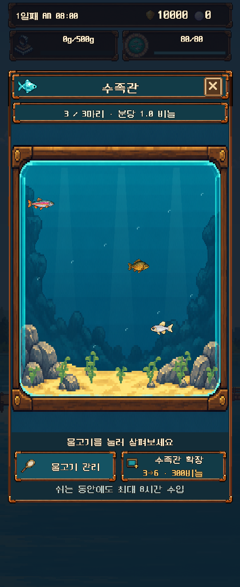
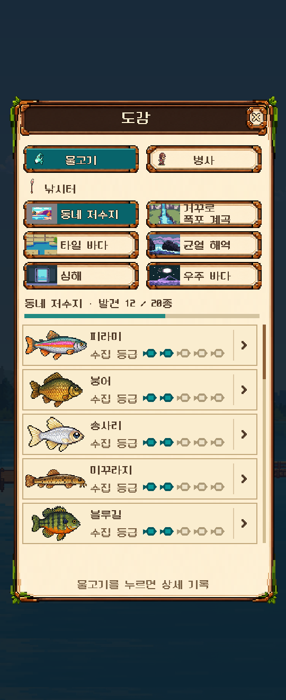
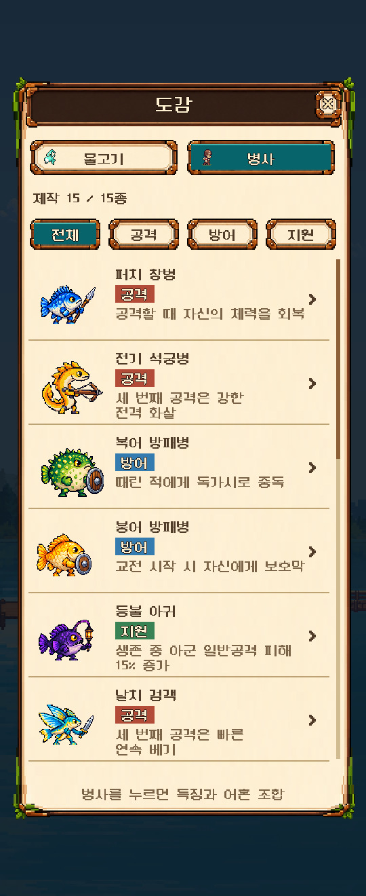
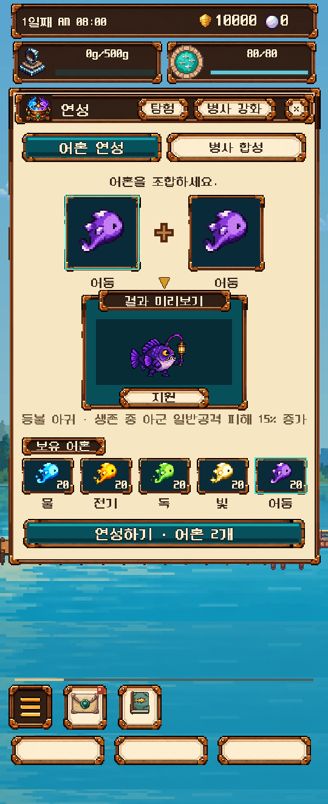
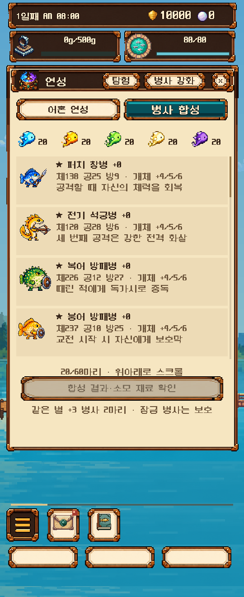

# v0.90 UI verification

User authorized implementation and deployment. Original two codex concepts were shown again. No paid art generation. Aquarium tank dimensions remain exactly `244 × (height-top_y-312)`; outer window now ends 94 logical pixels above screen bottom. Management and expansion controls share one row. Alchemy actions follow the result and owned souls. Fusion/training rosters accept wheel and native touch dragging, with drag selection suppression. Bag, shop, mailbox, guide, bundle, fishing-location back button and title version margins were audited and adjusted.

Rendered previews cover 270×480 and 270×660. All 52 automated suites passed. Work CI, release CI and the real public update gateway verification passed. Public source ZIP, PCK and version manifest were downloaded, hashed and compared with the verified source. See PUBLISHED.json. Phone installation remains unverified.

## Rendered game screens

