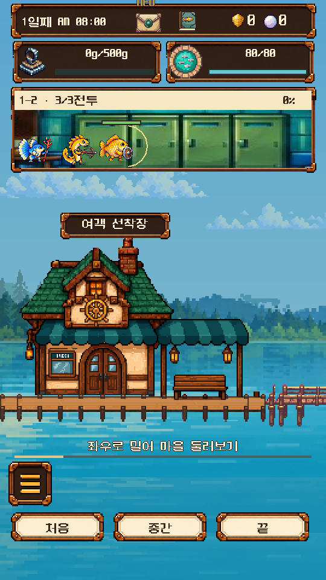

# 탐험 표기 수정 및 v0.80 전투 밸런스 분석

2026-10-26. 기준 공개 소스 `a74e060d8eda34ab6650c0d2d3d72d9e646b990d`, Godot 4.4.1.
표기 수정은 작업 브랜치에 저장하며 새 공개 배포는 하지 않는다. 아래 밸런스 후보는 분석 전용이며 실제 model.gd/catalog.json에는 적용하지 않았다.

## 결론

- 마을 표기 `2-3`은 **2번 방의 세 번째 전투**였다. 노선의 **1지역 2번 방(1-2)**과 다른 번호 체계를 사용했다. 실제 다른 방에서 전투한 문제가 아니다. 마을창을 `1-2 · 3/3전투`로 수정하고 출발·상세·결과 화면도 `1-N`으로 통일했다.
- 초반 체력이 줄지 않는 현상은 재현됐다. 붕어 방패병/전기 석궁병/물빛 치유사, 전원 1성 무강화, 개체값 각4에서 1-2의 적 공격 **25회 모두 체력 피해 0**, 방패병 체력100%였다.
- 초반은 전반적으로 너무 안전하지만, 전구간이 쉽지는 않다. 강화와 승급 효과가 보스방에 몰려 있고, 보스 다음 일반방이 다시 쉬워진다. 1성 최대 강화 균형조합은 현재 1-9에서125/125 성공하다가 1-10에서0/125가 된다.
- 보호막만 줄이는 시험안은 초반 체감 일부만 개선한다. 적 공격력을 높인 첫 시험안은 1-7의 최대강화 1성 균형조합을2/125까지 막으면서 1-8은125/125로 남겨 난도 역전을 해결하지 못했다.
- **구간별 조절 후보(curve)**가 가장 일관된 성장 흐름을 보였다. 무강화1성의 성공 조합은 1-3 113개→1-4 39개→1-5 9개, 최대강화1성은 1-7 97개→1-8 26개→1-9 1개로 줄어든다. 2성 방어+공격 최대강화는 1-9 125개, 1-10 119개 성공한다. 다만 실제 성장 재화 수급과 플레이 시간은 이번 전투 분석 범위 밖이므로 이 후보의 즉시 배포를 결론으로 삼지 않는다.

## 방법 및 검증

총 **1,261,250회**의 독립적인 방 단위 전투(각 방 최대3조우)를 실행했다.

- 현행 및4개 후보 ×241,250회 =1,206,250회.
- 현행/공격상향안의 개체값0·8 경계 검증4세트 ×13,750회 =55,000회.
- 단일 별 등급/강화 프로필7개는15종의 순서 있는3인 편성 **3,375개 전수** ×10방을 검증했다. 동일 종도 서로 다른 병사로 편성 가능하므로 중복 종 조합을 포함한다.
- 혼합 별 프로필4개는 방어/공격/지원 순서의125조합 ×10방을 검증했다. 표의 모든 행은 비교 기준을 맞추기 위해 이125조합으로 제한했다. 전체3,375조합 결과는 summary.csv에 별도 보존했다.
- 기본 개체값은 세 능력치 모두4, 경계 검증은 모두0 또는8이다. 서로 다른 개체값이 섞인 모든 조합이나3성 희귀도 추가 보너스는 전수조사하지 않았다.
- 실제 출시 model.gd의 `tick()`을 호출했다. 화면 연출 대기만 생략했고 독자적으로 전투 공식을 재작성하지 않았다. 후보는 테스트용 상속 모델과 메모리상의 적 능력치만 바꿨다.
- 빠른 실행과 실제 `update(0.1)` 실행을 **600조건**에서 비교하여 전원 최종 상태·승패·보상이 일치했다. 이는 추가1,200회 실행이며 위 전수조사 횟수에는 포함하지 않았다.
- 전투에는 동일 상태에서 승패를 바꾸는 난수가 없다. 아래 수치는 확률적 승률이 아니라 **서로 다른 편성 중 클리어한 편성 수**다. 동일 전투를 반복해 횟수만 부풀리지 않았다.
- 방마다 체력·회복·첫 클리어 상태를 초기화했다. 자원 획득→강화→진행의 경제 시뮬레이션이나 이용자 실제 편성 분포는 아니다.

## 원인

피해 공식은 `max(1, round(공격력 × 0.2 × 100 / (100+방어력)))`다. 병사3명이 공격하는 동안 적은 선두1명을 공격한다. 초반 적 공격은 낮은 정수로 반올림되고, 붕어 방패병은 매 조우 체력의22% 보호막을 새로 얻는다. 피해를20%로 줄여 전투를 늘린 데 비해 시작 보호막은 그대로라 초반에는 보호막 소모 전에 적이 죽기 쉽다. 치유와 지원이 더해지면 체력 변화가 더 작아진다.

따라서 방어력만 일괄 하향하거나 모든 적을 같은 비율로 강화하면 이미 어려운 후반 보스와 약한 편성에 불리하다. 보호막·초반 적 타격·방별 난도 흐름을 함께 다루는 것이 적절하다.

## 현재: 성공 조합 수 /125

| 편성 | 1-1 | 1-2 | 1-3 | 1-4 | 1-5 | 1-6 | 1-7 | 1-8 | 1-9 | 1-10 |
|---|---:|---:|---:|---:|---:|---:|---:|---:|---:|---:|
| 1성 무강화 | 125 | 125 | 125 | 125 | 98 | 125 | 2 | 119 | 64 | 0 |
| 1성 강화 1 | 125 | 125 | 125 | 125 | 125 | 125 | 20 | 125 | 125 | 0 |
| 1성 강화 2 | 125 | 125 | 125 | 125 | 125 | 125 | 81 | 125 | 125 | 0 |
| 1성 최대 강화 | 125 | 125 | 125 | 125 | 125 | 125 | 123 | 125 | 125 | 0 |
| 방어만 2성·최대 강화 | 125 | 125 | 125 | 125 | 125 | 125 | 125 | 125 | 125 | 24 |
| 공격만 2성·최대 강화 | 125 | 125 | 125 | 125 | 125 | 125 | 125 | 125 | 125 | 4 |
| 지원만 2성·최대 강화 | 125 | 125 | 125 | 125 | 125 | 125 | 125 | 125 | 125 | 1 |
| 방어+공격 2성·최대 강화 | 125 | 125 | 125 | 125 | 125 | 125 | 125 | 125 | 125 | 123 |
| 전원 2성 무강화 | 125 | 125 | 125 | 125 | 125 | 125 | 125 | 125 | 125 | 1 |
| 전원 2성 최대 강화 | 125 | 125 | 125 | 125 | 125 | 125 | 125 | 125 | 125 | 125 |
| 전원 3성 무강화 | 125 | 125 | 125 | 125 | 125 | 125 | 125 | 125 | 125 | 125 |

최대강화1성으로 1-7을 통과하는 균형조합은123개지만, 순서·역할 제한 없는 전체편성에서는1,856/3,375개다. 역할을 갖춘 편성과 무작위 편성을 같은 모집단으로 섞어 해석하면 안 된다. 2성 최대강화도 전체편성 기준으로는 마지막 방 성공 비율73.81%지만 균형조합에서는125/125다. 조합 효과는 이미 존재하며 초반에서 잘 드러나지 않는 문제가 크다.

## 시험안 정의

모든 계수는 기준v0.80 대비이며 반올림 후 사용했다. 방별 계수는 해당 방의 세 적 모두에 적용했다.

| 시험안 | 붕어 시작 보호막 | 방1→10 적 공격력 배율 | 적 체력 |
|---|---|---|---|
| current | 체력22% | 모두1 | 원본 |
| shield | 체력4.4% | 모두1 | 원본 |
| pressure | 체력4.4% | 3, 3, 2.5, 2.5, 2, 2, 1.7, 1.6, 1.5, 1 | 원본 |
| pressure_hp | 체력4.4% | pressure와 동일 | 1~9방1.25배,10방 원본 |
| curve | 체력4.4% | 3, 3, 2.1, 3.5, 1.65, 3.5, 1.1, 3, 3, 1 | 원본 |

`pressure_hp`는1-7에서 최대강화1성 균형조합0/125, 2성 방어 한명은68/125로 줄이며 보스벽을 더 높였다. 적 체력 일괄 증가는 권하지 않는다.

## 구간별 조절 후보(curve): 성공 조합 수 /125

| 편성 | 1-1 | 1-2 | 1-3 | 1-4 | 1-5 | 1-6 | 1-7 | 1-8 | 1-9 | 1-10 |
|---|---:|---:|---:|---:|---:|---:|---:|---:|---:|---:|
| 1성 무강화 | 125 | 125 | 113 | 39 | 9 | 0 | 0 | 0 | 0 | 0 |
| 1성 강화 1 | 125 | 125 | 125 | 119 | 55 | 8 | 3 | 0 | 0 | 0 |
| 1성 강화 2 | 125 | 125 | 125 | 125 | 112 | 58 | 48 | 2 | 0 | 0 |
| 1성 최대 강화 | 125 | 125 | 125 | 125 | 125 | 123 | 97 | 26 | 1 | 0 |
| 방어만 2성·최대 강화 | 125 | 125 | 125 | 125 | 125 | 125 | 125 | 125 | 112 | 18 |
| 공격만 2성·최대 강화 | 125 | 125 | 125 | 125 | 125 | 125 | 125 | 125 | 57 | 1 |
| 지원만 2성·최대 강화 | 125 | 125 | 125 | 125 | 125 | 125 | 125 | 95 | 23 | 0 |
| 방어+공격 2성·최대 강화 | 125 | 125 | 125 | 125 | 125 | 125 | 125 | 125 | 125 | 119 |
| 전원 2성 무강화 | 125 | 125 | 125 | 125 | 125 | 125 | 125 | 112 | 31 | 0 |
| 전원 2성 최대 강화 | 125 | 125 | 125 | 125 | 125 | 125 | 125 | 125 | 125 | 125 |
| 전원 3성 무강화 | 125 | 125 | 125 | 125 | 125 | 125 | 125 | 125 | 125 | 125 |

이 후보의 1-2 무강화 균형조합은125개 모두 통과하지만 선두 잔여체력 중앙값36.73%다. 대표 붕어/석궁/치유 편성도 원본100%에서43.04%로 내려가 전투의 부담이 보인다. 최대강화 동일 편성은84.62%로 끝나 성장 효과도 드러난다.

후보의 한계: 마지막 방의2성 방어+공격 성공119/125에 비해2성 공격 한명1/125, 지원 한명0/125로 방어 승급의 영향이 크다. 선두 집중 타격 구조와 역할별 승급 효율 조정 여부는 별도 설계가 필요하다. curve는 개체값4에서 검증했으며 경계 개체값 검증은 current/pressure에만 수행했다.

## 개체값 민감도

현재 균형조합 1성 최대강화의1-7 성공은 개체값0에서108/125,4에서123/125,8에서125/125다. 2성 방어+공격 최대강화의1-10 성공은110/125→123/125→125/125다. 현행에서 초반이 쉽고10방에서 급격히 어려워지는 큰 방향은 경계 개체값에서도 유지됐다.

## 표시 및 회귀검사

- 10방 ×3조우 표기와 대기 상태 검사 통과.
- expedition_label, expedition_motion, expedition080 포함 로컬 전체37개 회귀검사 통과.
- 두 화면 높이480/660에서 `1-2 · 3/3전투`가 잘리지 않고 표시되는 것을 렌더링 확인.
- 작업 브랜치 CI에 expedition_label_verify 추가. CI 결과는 최신 HANDOFF 참조.



## 재현과 자료 해석

프로젝트 소스를 복원한 뒤:

```sh
python automation/expedition_balance_analysis.py --godot /path/to/Godot_v4.4.1 --project /path/to/game --out /path/to/results
```

pandas가 필요하다. 실행기는9개CSV와 로그,summary.csv/json,manifest.json,parity.json을 생성한다. 개별 전투 원본CSV는 이번 실행 작업공간에 보존했고, 저장소에는 집계표·행수·SHA256·실행 코드와 검증 결과를 보존한다. 원본을 다시 생성하여 manifest의 해시로 비교할 수 있다.

`summary.csv`: enumerated는 각 프로필의 전체 조사 편성, defense_attack_support는 역할별125편성이다. 혼합별 프로필은 두 범위가 동일하다. median_front_hp_percent는 패배/전사 포함 선두 체력 중앙값으로 팀전체 체력과 다르다. median_ticks×1.5는 타격 간격 누계이며 조우 입장/퇴장 연출을 포함한 실 플레이 시간은 아니다.

원본CSV의 legacy 이름 raw_damage는 보호막 이후 실제 체력 피해(치유 이전) 누계다. healed는 지원 스킬의 실제 회복량만 세며 흡혈/자가재생을 포함하지 않는다. shield_given도 지원 스킬의 추가량만 세며 시작 보호막은 제외한다. 이 세 항목을 총 피해/총 치유/총 보호막으로 해석하지 않았다.
